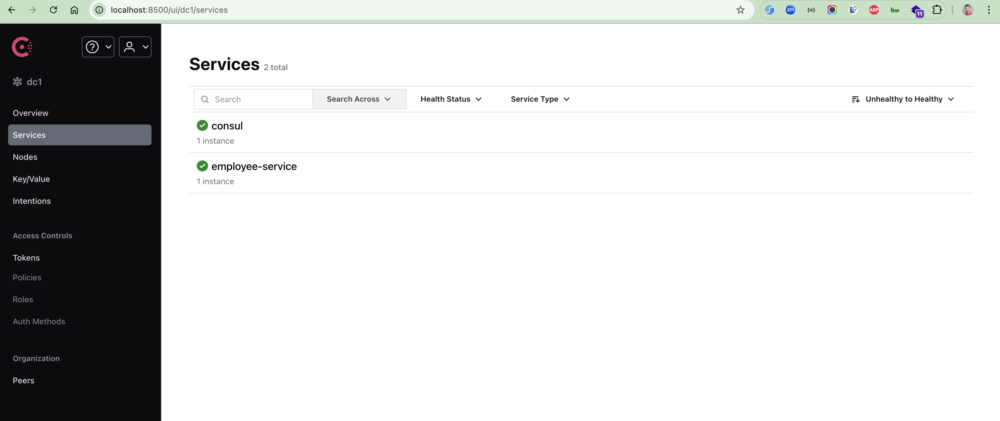
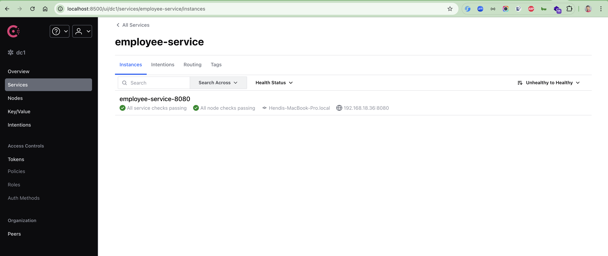
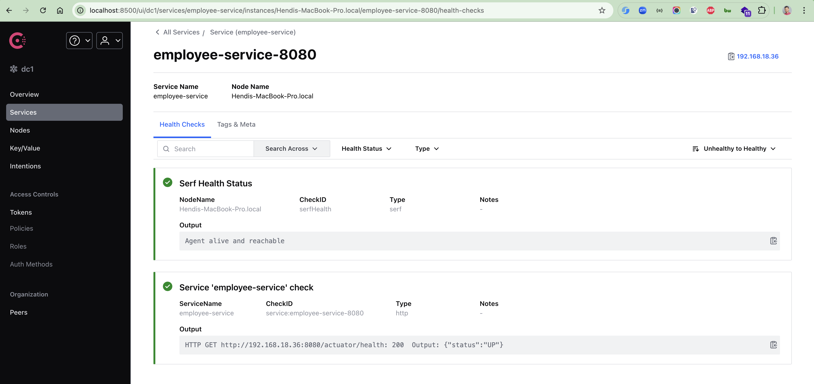

# spring-boot-consul

[](https://github.com/hendisantika/spring-boot-consul/actions/workflows/gradle.yml)

Spring Boot service (`employee-service`) that registers itself in [Consul](https://developer.hashicorp.com/consul) for
service discovery and loads its configuration from the Consul key/value store.

### Tech Stack

| Component    | Version               |
|--------------|-----------------------|
| Java         | 25                    |
| Spring Boot  | 4.1.1                 |
| Spring Cloud | 2025.1.3 (Consul)     |
| Gradle       | 9.8.1 (wrapper)       |

### Prerequisites

- JDK 25 (the Gradle toolchain is set to Java 25)
- A running Consul agent on `localhost:8500`, for example:
  `docker run -d --name consul -p 8500:8500 hashicorp/consul agent -dev -client=0.0.0.0`

### Things to do list

1. Clone this repository: `git clone https://github.com/hendisantika/spring-boot-consul.git`
2. Navigate to the folder: `cd spring-boot-consul`
3. Make sure your Consul server is already up
4. Run the application: `./gradlew clean bootRun`
5. Open your favorite browser: http://localhost:8500 (Consul UI); the service runs on http://localhost:8080

### Build & Test

```shell
./gradlew build
```

Tests use `src/test/resources/application.yml`, which disables Spring Cloud Consul, so they run without a Consul
agent (as on GitHub Actions).

### Image Screenshot

Consul Home Page



Consul Service Page



Consul Details Service Page


